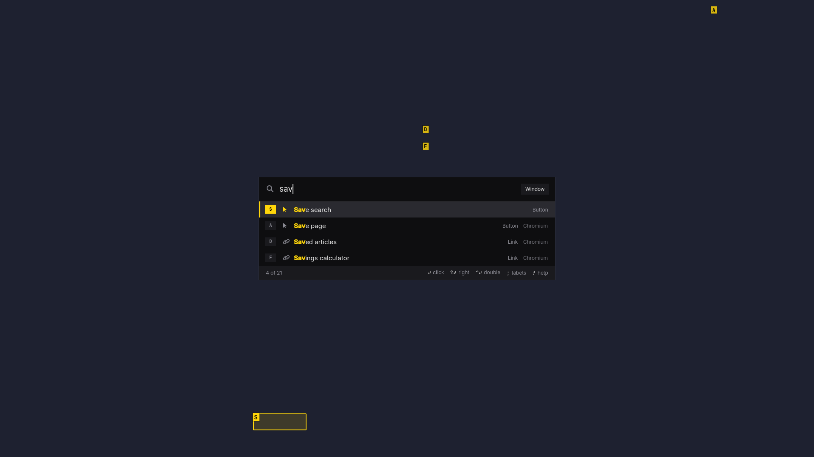
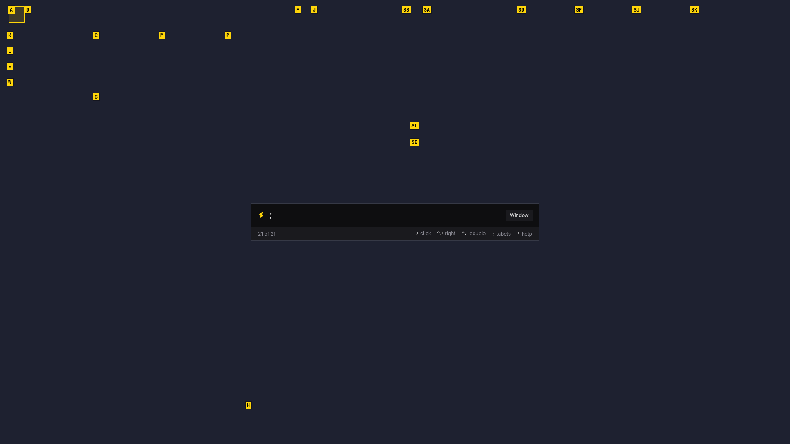

# pounce

Click anything on screen from the keyboard. Press a key, type a few letters of
a button, link, tab, field, or menu item, and press Enter. Or put a label on
everything and type the label. It's built for [Omarchy](https://omarchy.org)
and Hyprland.





## What it does

- **Search by name.** Fuzzy matching is tuned for UI labels. `sa` finds
  *Save As* by its initials, `new tab` finds *Open new tab*, and `reglages`
  finds *Réglages*. Exact and prefix matches always rank first.
- **Labels, Vimium-style.** Every element gets a short home-row label that
  stays put while you search. Type a label and press Enter to click it, or
  type `;` first and the label clicks as soon as it's complete. `save;s`
  labels only what matches "save". Type a label in UPPERCASE after `;` to
  right-click instead.
- **Clicks without moving the mouse.** A plain click goes through the
  widget's own accessibility action, so the pointer stays put and it works on
  windows that are partly covered. Right, middle, and double clicks, hovering,
  and widgets without an action use a Wayland virtual pointer. No ydotool and
  no uinput permissions are needed.
- **The whole screen.** Ctrl+S switches between the focused window and every
  visible window on every monitor. Clicking in another window focuses it
  first.
- **Learns.** The elements you pick most rise to the top of vague searches,
  and old picks fade with a two-week half-life.
- **Fast.** pounce stays resident and reads the accessibility tree with
  hundreds of D-Bus requests in flight at once. A typical window is read in
  5–40 ms, and results stream in while a large page is still being read.
- **Stays out of the way.** The search is one slim line showing what Enter
  would click; the full list of matches opens only when asked for. Label
  mode has no panel at all, just a small chip in the corner. The bar moves to
  whichever part of the screen hides the fewest elements, fades when the
  selected element is behind it, and holding Alt hides everything until it's
  let go.
- **Looks like Omarchy.** It follows the theme's accent, backgrounds, and
  Hyprland's window rounding live, and follows the Omarchy language
  (11 languages so far).
- **Scriptable.** `pounce list` and `pounce click` work headless, with
  `--json`, for scripts and coding agents.

## Keys

| Key | Does |
| --- | --- |
| Super+; | Open (bound by you, see below) |
| Enter | Click the selected element |
| Shift+Enter | Right-click |
| Ctrl+Enter | Double-click |
| Ctrl+Shift+Enter | Middle-click (open a link in a new tab) |
| Alt+Enter | Move the pointer there |
| ↓ or Ctrl+L | Show the full list of matches (Esc folds it) |
| ↑ ↓, Tab, Ctrl+N/P, Ctrl+J/K | Move the selection |
| Hold Alt | See the screen without pounce |
| Alt+1…9 | Click result 1 to 9 |
| A label, then Enter | Select the labelled element and click it |
| `;` | Label everything; type a label to click |
| `text;label` | Label only what matches *text* |
| UPPERCASE label | Right-click by label |
| Ctrl+S | Switch between this window and the whole screen |
| Ctrl+R | Read the screen again |
| Ctrl+U | Clear the search |
| `?` or F1 | Show every key |
| Esc | Close |

Clicking a label or a result with the mouse works too.

## Install

```sh
bin/install          # builds and installs the Arch package
pounce setup         # switches on accessibility for apps and Chromium
pounce doctor        # checks that everything is in place
```

Then bind it in `~/.config/hypr/bindings.lua`:

```lua
o.bind("SUPER + SEMICOLON", "Pounce", "pounce")
o.bind("SUPER + SHIFT + SEMICOLON", "Pounce labels", "pounce hints")
```

The first press starts pounce in the background. To have it ready from login,
add `o.exec_on_start("pounce daemon")` to `~/.config/hypr/autostart.lua`.

### Which apps work

pounce sees whatever an app exposes to the Linux accessibility bus (AT-SPI):

| Toolkit | Works |
| --- | --- |
| GTK 3 and 4 (Nautilus, most GNOME apps) | Out of the box |
| Qt 5 and 6 (KDE apps, Omarchy's own apps) | Once accessibility is on (`pounce setup`) |
| Chromium | After `pounce setup` and a Chromium restart (`--force-renderer-accessibility`) |
| Electron apps | When started with `--force-renderer-accessibility`; Arch's system Electron reads `~/.config/electron-flags.conf`, which `pounce setup` writes |
| Firefox | Once accessibility is on |
| Terminals, games, canvas-drawn apps | No; they have no accessibility tree |

When a window shares nothing, the overlay names it and says what to do.

## Configuration

`~/.config/pounce/config.json`. Every key is optional and the file is read
each time the overlay opens:

```json
{
  "scope": "window",
  "activation": "auto",
  "hintAlphabet": "sadfjklewcmpgh",
  "restorePointer": false,
  "dim": 0.18,
  "scanTimeoutMs": 2500
}
```

- `scope`: `window` (the focused window) or `screen` (every visible window).
- `activation`: `auto` uses accessibility actions where there are any,
  `pointer` always clicks with the virtual pointer.
- `hintAlphabet`: lowercase letters for labels, most comfortable first.
- `restorePointer`: put the pointer back after a pointer click.
- `dim`: how much the screen darkens behind the labels, 0 to 0.8.

## For scripts and agents

```sh
pounce list --screen --json        # everything clickable on screen
pounce click "Save"                # click the best match in the focused window
pounce click --right --index 2 file.txt
pounce click --dry-run "Delete"    # say what would be clicked
pounce skill install               # teach Claude Code to use pounce
```

Each command exits 0 on success and 1 on failure, with the reason on stderr.

## How it works

1. Hyprland's command socket gives the windows, monitors, and focus.
2. The accessibility bus lists the apps. Each window is matched to its
   app's toplevel frame by process, title, and size.
3. The frame's subtree is read breadth first with every D-Bus call
   asynchronous. Hidden subtrees are cut off by their state, and only
   interactive elements are asked for their name, rectangle, and actions.
4. Wayland apps report positions relative to their window, and Chromium
   reports page content in device pixels. Both are mapped into Hyprland's
   layout using the window's geometry and the monitor's scale.
5. One layer-shell overlay per monitor draws the labels. The one on the
   focused monitor holds the keyboard and the search panel.

## Develop

```sh
bin/build      # build/pounce
bin/test       # unit tests, offscreen
```

C++17 and Qt 6 Quick, built with qmake. No CMake, no runtime dependencies
beyond Qt, layer-shell-qt, and the accessibility bus.

## License

MIT
